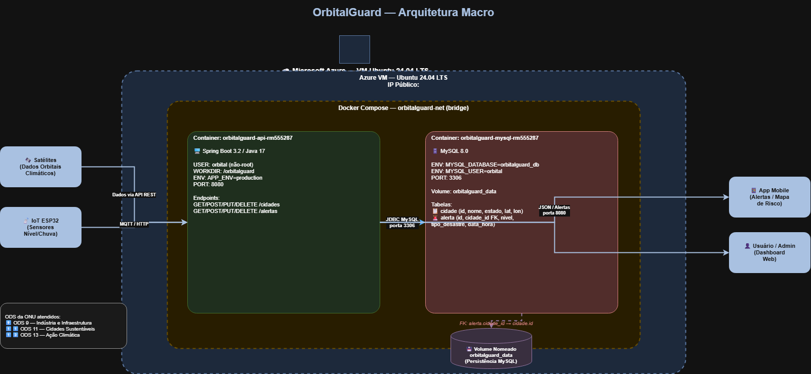

# OrbitalGuard — Global Solution FIAP 2026/2

> **CitizenTech: tecnologia para o cidadão — clima e emergências.**

Sistema inteligente de monitoramento e prevenção de desastres naturais (enchentes, deslizamentos e queimadas) utilizando dados de satélite, sensores IoT e inteligência artificial.

---

## Equipe

| RM | Nome |
|---|---|
| RM555287 | João Victor Rebello de Santis |
| RM562279 | Raphael Gomes Mancera |
| RM566366 | Bruno Vinicius Barbosa |
| RM566087 | Guilherme de Andrade Martini |
| RM555427 | Gabriel Gomes Mancera |

**Turma:** 2TDSPW — DevOps Tools & Cloud Computing

---

## Vídeo Demonstrativo

[](https://youtu.be/PABMV5TqBv4)

🔗 [https://youtu.be/PABMV5TqBv4](https://youtu.be/PABMV5TqBv4)

---

## Descrição da Solução

O **OrbitalGuard** conecta a exploração espacial com problemas reais na Terra. Satélites coletam dados climáticos e orbitais que são processados por IA para identificar riscos de desastres naturais. A API centraliza alertas em tempo real, permitindo que autoridades e cidadãos tomem decisões antes que o desastre aconteça.

**Problema resolvido:** cidades brasileiras sofrem com enchentes, deslizamentos e queimadas por falta de monitoramento preventivo eficiente.

**ODS da ONU atendidos:** ODS 9 (Indústria e Infraestrutura), ODS 11 (Cidades Sustentáveis), ODS 13 (Ação Climática).

---

## Arquitetura



---

## Tecnologias

| Camada | Tecnologia |
|---|---|
| Linguagem | Java 17 |
| Framework | Spring Boot 3.2 |
| ORM | Spring Data JPA + Lombok |
| Banco de Dados | MySQL 8.0 |
| Containerização | Docker + Docker Compose |
| CI/CD | Azure DevOps Pipelines |
| Testes | JUnit 5 + Mockito (via Spring Boot Test) |
| Cloud | Microsoft Azure (ACI — Azure Container Instances) |

---

## Estrutura do Projeto

```
orbitalguard/
├── azure-pipeline.yml          # CI/CD pipeline — Azure DevOps
├── docker-compose.yml          # Orquestração local
├── dockerfiles/
│   └── Dockerfile              # Build multi-stage (Maven → JRE Alpine)
├── scripts/
│   ├── script-bd.sql           # DDL + dados iniciais do banco
│   └── provision.azcli         # Provisionamento de infraestrutura Azure CLI
├── orbitalguard-api/
│   ├── pom.xml
│   └── src/
│       ├── main/java/br/com/orbitalguard/
│       │   ├── OrbitalGuardApplication.java
│       │   ├── controller/
│       │   │   ├── CidadeController.java
│       │   │   └── AlertaController.java
│       │   ├── model/
│       │   │   ├── Cidade.java
│       │   │   └── Alerta.java
│       │   └── repository/
│       │       ├── CidadeRepository.java
│       │       └── AlertaRepository.java
│       └── test/java/br/com/orbitalguard/
│           ├── OrbitalGuardApplicationTests.java
│           └── controller/
│               ├── CidadeControllerTest.java
│               └── AlertaControllerTest.java
└── orbitalguard-mysql/
    └── init.sql
```

---

## Banco de Dados

Duas tabelas com relacionamento FK:

**cidade** — cidades monitoradas pelo sistema
- `id`, `nome`, `estado`, `latitude`, `longitude`, `populacao`

**alerta** — alertas gerados por análise orbital/satelital
- `id`, `cidade_id` (FK → cidade), `nivel`, `descricao`, `tipo_desastre`, `data_hora`, `ativo`

---

## CI/CD — Azure DevOps Pipeline

O arquivo [`azure-pipeline.yml`](azure-pipeline.yml) define o pipeline com dois estágios:

| Estágio | Trigger | O que faz |
|---|---|---|
| **Build** | Push ou PR para `main` | Java 17, `mvn test`, publica resultados JUnit, `mvn package`, publica artefato |
| **Release** | Após Build com sucesso em `main` | Deploy automático no Azure Container Instances |

### Branch Policy (configurar no Azure DevOps)
- Requer PR para fazer merge em `main`
- Reviewer obrigatório: RM555287 (João Victor)
- Deve ter Work Item linkado
- Build deve passar antes do merge

---

## Endpoints da API

Base URL: `http://<FQDN_ACI>:8080`

### Cidades
| Método | Endpoint | Descrição |
|---|---|---|
| GET | `/cidades` | Lista todas as cidades |
| GET | `/cidades/{id}` | Busca cidade por ID |
| POST | `/cidades` | Cadastra nova cidade |
| PUT | `/cidades/{id}` | Atualiza cidade |
| DELETE | `/cidades/{id}` | Remove cidade |

### Alertas
| Método | Endpoint | Descrição |
|---|---|---|
| GET | `/alertas` | Lista todos os alertas |
| GET | `/alertas/ativos` | Lista apenas alertas ativos |
| GET | `/alertas/{id}` | Busca alerta por ID |
| GET | `/alertas/cidade/{cidadeId}` | Alertas de uma cidade |
| POST | `/alertas` | Cria novo alerta |
| PUT | `/alertas/{id}` | Atualiza alerta |
| DELETE | `/alertas/{id}` | Remove alerta |

---

## How To — Executar Localmente

### Pré-requisitos

- Git, Docker e Docker Compose instalados

### 1. Clonar o repositório

```bash
git clone https://dev.azure.com/<org>/OrbitalGuard/_git/OrbitalGuard
cd OrbitalGuard
```

### 2. Subir os containers

```bash
docker compose up -d --build
```

Aguarde ~40 segundos para o MySQL inicializar.

### 3. Verificar containers

```bash
docker ps
```

### 4. Executar SELECT nas duas tabelas

```bash
docker container exec -it orbitalguard-mysql-rm555287 bash
mysql -u orbital -porbital123 orbitalguard_db

SELECT * FROM cidade;
SELECT * FROM alerta;
SELECT c.nome, a.nivel, a.tipo_desastre
FROM alerta a JOIN cidade c ON a.cidade_id = c.id
WHERE a.ativo = 1;
exit
exit
```

### 5. Parar os containers

```bash
docker compose down
```

---

## How To — Provisionar na Azure (Azure CLI)

```bash
# Autenticar no Azure
az login

# Executar script de provisionamento
bash scripts/provision.azcli
```

O script cria automaticamente:
- Resource Group `rg-orbitalguard-gs2026`
- Container MySQL 8.0
- Container da API Spring Boot com DNS público

---

## How To — Executar os Testes

```bash
cd orbitalguard-api
mvn test
```

Os testes usam H2 (in-memory) — não precisam de MySQL rodando.

---

## Autores

| RM | Nome |
|---|---|
| RM555287 | João Victor Rebello de Santis |
| RM562279 | Raphael Gomes Mancera |
| RM566366 | Bruno Vinicius Barbosa |
| RM566087 | Guilherme de Andrade Martini |
| RM555427 | Gabriel Gomes Mancera |

FIAP — Global Solution 2026/2 — DevOps Tools & Cloud Computing
